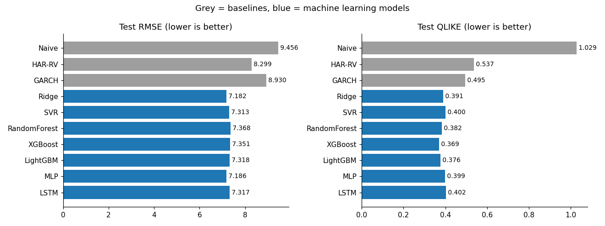
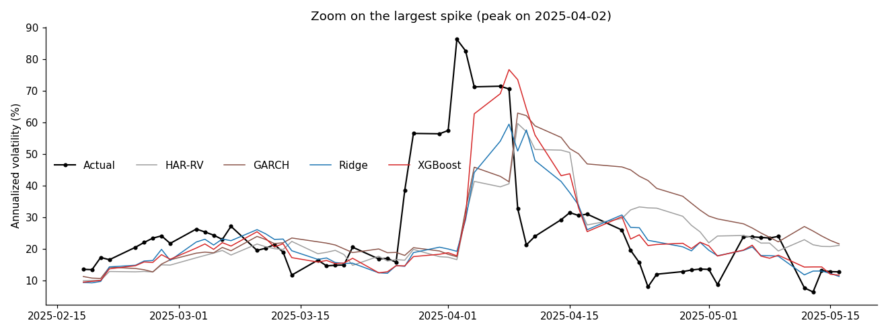
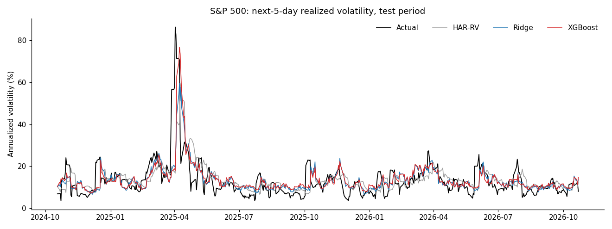

# Forecasting S&P 500 Volatility: Machine Learning vs. HAR-RV and GARCH

Can machine learning forecast stock market volatility better than the classic models from the finance literature? This project forecasts the **realized volatility of the S&P 500 over the next 5 trading days** and compares **7 machine learning models** against three benchmarks, using time-series cross-validation, grid search, statistical significance tests and a feature ablation study.

## Key findings

1. **All 7 machine learning models beat HAR-RV and GARCH**, by 11-13% in RMSE (vs. HAR-RV, the best baseline in RMSE) and 19-25% in QLIKE (vs. GARCH, the best baseline in QLIKE), and the Diebold-Mariano test confirms these gains are statistically significant (p < 0.01 in both loss functions).
2. **A simple linear model is as good as the complex ones.** Ridge regression had the lowest RMSE, and no model (XGBoost, LightGBM, MLP, LSTM...) was significantly better than Ridge.
3. **The gain comes from the features, not the model.** With the same 3 features as HAR-RV, Ridge performs the same as HAR-RV. Adding the **VIX** alone delivers most of the improvement.
4. **No model anticipated the April 2025 shock.** The advantage of the ML models is that they react faster when volatility jumps and come back down faster when it calms, while GARCH stayed too high for weeks after the spike.

## Results

Test period: 18 October 2024 to 22 October 2026 (504 trading days), never used for tuning.

| Model | Type | RMSE | MAE | QLIKE |
|---|---|---|---|---|
| Naive (last week's volatility) | Baseline | 9.456 | 5.661 | 1.029 |
| HAR-RV | Baseline | 8.299 | 5.090 | 0.537 |
| GARCH(1,1), Student-t | Baseline | 8.930 | 5.734 | 0.495 |
| **Ridge** | ML | **7.182** | 4.225 | 0.391 |
| SVR (RBF) | ML | 7.313 | 4.195 | 0.400 |
| Random Forest | ML | 7.368 | 4.353 | 0.382 |
| **XGBoost** | ML | 7.351 | 4.231 | **0.369** |
| LightGBM | ML | 7.318 | 4.250 | 0.376 |
| MLP | ML | 7.186 | 4.257 | 0.399 |
| **LSTM** | ML | 7.317 | **4.183** | 0.402 |

Volatility is annualized and in percent. Lower is better for all metrics.



### Statistical significance (Diebold-Mariano test)

| Comparison | Squared error | QLIKE |
|---|---|---|
| Every ML model vs. HAR-RV | All better, p between 0.0007 and 0.0098 | All better, p between 0.0009 and 0.0090 |
| Every ML model vs. Ridge | No significant difference (all p > 0.11) | No significant difference (all p > 0.33) |
| GARCH vs. HAR-RV | No significant difference (p = 0.14) | No significant difference (p = 0.21) |

With 14 comparisons against HAR-RV, a strict Bonferroni correction (threshold 0.0036) would not pass every comparison on its own, but all 14 point in the same direction.

### Where does the improvement come from? (feature ablation)

Same tuned models, different feature sets:

| Features | Ridge RMSE | XGBoost RMSE | Ridge QLIKE | XGBoost QLIKE |
|---|---|---|---|---|
| A: HAR only (3 features) | 8.259 | 8.923 | 0.525 | 0.475 |
| B: HAR + VIX | 7.339 | 7.581 | 0.406 | 0.378 |
| C: HAR + Parkinson | 8.003 | 8.404 | 0.487 | 0.445 |
| D: HAR + VIX + Parkinson | 7.355 | 7.588 | 0.399 | 0.378 |
| E: All 10 features | **7.182** | 7.351 | 0.391 | **0.369** |

- **VIX is the main driver:** adding it cut RMSE by 11% and QLIKE by 23%. VIX is built from option prices, so it carries the market's expectation of future volatility, not just past volatility.
- **Parkinson volatility adds nothing once VIX is included** (B and D are almost identical), even though it is strongly correlated with the target on its own.
- **Ridge is better in RMSE and XGBoost in QLIKE in every feature set.** RMSE is dominated by large errors on crisis days and QLIKE by relative errors on calm days, so a likely (unproven) explanation is that Ridge handles spikes better and XGBoost handles calm periods better.

### The April 2025 volatility spike





## Method

**Data:** daily S&P 500 prices and the VIX index from January 2000 to October 2026 (6,720 trading days after building features).

**Target:** annualized realized volatility over the next 5 trading days, computed from daily squared log returns.

**Features (10)**, all known at the close of day t:

| Group | Features |
|---|---|
| HAR | Realized volatility over 1, 5 and 22 days |
| Range-based | Parkinson volatility (from daily high and low), 1 and 5 days |
| Market expectations | VIX level and its daily change |
| Returns | 1-day and 5-day returns (falling markets raise volatility: the leverage effect) |
| Volume | Trading volume relative to its 22-day average |

**Avoiding look-ahead bias:**

- Features use only data up to day t, and the target only days t+1 to t+5.
- The last 504 days are held out as a test set, with a **5-day embargo** between train and test because 5-day targets overlap.
- Grid search uses `TimeSeriesSplit` (5 folds, 5-day gap): each fold trains on the past and validates on the period after it.
- Feature scaling is fitted inside each training fold (scikit-learn `Pipeline`).
- GARCH parameters are estimated on the training period only, then fixed during the test period.
- The LSTM picks its configuration on a time-based validation split, never on the test set.

**Hyperparameter tuning:** a first grid search for each model, then a second, wider search for models whose best value landed on the edge of the grid. In the second pass, SVR and MLP kept moving toward simpler, more regularized settings, which matches the finding that the signal is mostly linear.

**Evaluation:** RMSE, MAE and QLIKE (the standard volatility loss, which penalizes under-predicting volatility more than over-predicting it), plus Diebold-Mariano tests with a HAC variance and the Harvey-Leybourne-Newbold small-sample correction.

## Limitations

- **One test period.** Results come from a single 2-year window, dominated by one large shock (April 2025). Exact numbers may differ on another period.
- **Daily data only.** Realized volatility is computed from daily close-to-close returns, which is a noisy measure. Intraday (high-frequency) data would give a more accurate target.
- **Static models.** Models are trained once and not re-estimated during the test period. Rolling re-estimation could change the results, especially for GARCH.
- **HAR-RV in levels.** The log version of HAR-RV is sometimes a stronger benchmark and was not tested.
- **Tuned for RMSE.** Grid search optimizes RMSE, so QLIKE results were not directly optimized.
- **LSTM training data.** The LSTM is trained on 80% of the training period because it needs a separate validation set for early stopping.
- **Forecast accuracy only.** No trading or risk-management backtest (for example, volatility targeting) is included.

## Project structure

```
volatility-forecasting-ml/
├── volatility_forecasting.ipynb   # full pipeline: data, models, tests, figures
├── figures/                       # charts used in this README
│   ├── model_comparison.png
│   ├── forecasts_spike_zoom.png
│   └── forecasts_test_period.png
├── requirements.txt
└── README.md
```

## How to run

### On Kaggle

1. Upload `volatility_forecasting.ipynb` and turn **Internet** on in the session options.
2. Run all cells (about 20-25 minutes on a CPU session).

### Locally

```bash
pip install -r requirements.txt
jupyter notebook volatility_forecasting.ipynb
```

Results can differ slightly from the tables above when run on a later date, because the data and test period move forward.

## Data

Price and VIX data come from Yahoo Finance through the unofficial [`yfinance`](https://github.com/ranaroussi/yfinance) library. **The data files are not included in this repository**, because Yahoo Finance's terms restrict redistributing its data. Running the notebook downloads the data and creates a `data/` folder with the features, predictions and result tables. The project is intended for educational and research use only.

## Author

**Dr. Faten Alzazah** · PhD in Computer Science (Middlesex University London) · Research in financial sentiment analysis and stock market prediction
